<p align="center"></p>

<h1 align="center">Pulse</h1>

<p align="center"><b>Habits and workouts, streak by streak.</b><br>A Flutter habit and workout tracker where motion leads: a splash that traces a heartbeat into a tick, a check-off that bursts, a GitHub-style streak heatmap and live, springy charts.</p>

<p align="center">
  <a href="https://alok-kul5.github.io/pulse-habits/"><b>Open the live demo</b></a> (best at phone width) · <a href="https://alok-kul5.github.io/pulse-habits/?tab=stats&splash=0">jump to Stats</a> · <a href="https://alok-kul5.github.io/pulse-habits/?habit=read&splash=0">a habit up close</a>
</p>

[](https://github.com/alok-kul5/pulse-habits/actions/workflows/ci.yml)


<p align="center">
  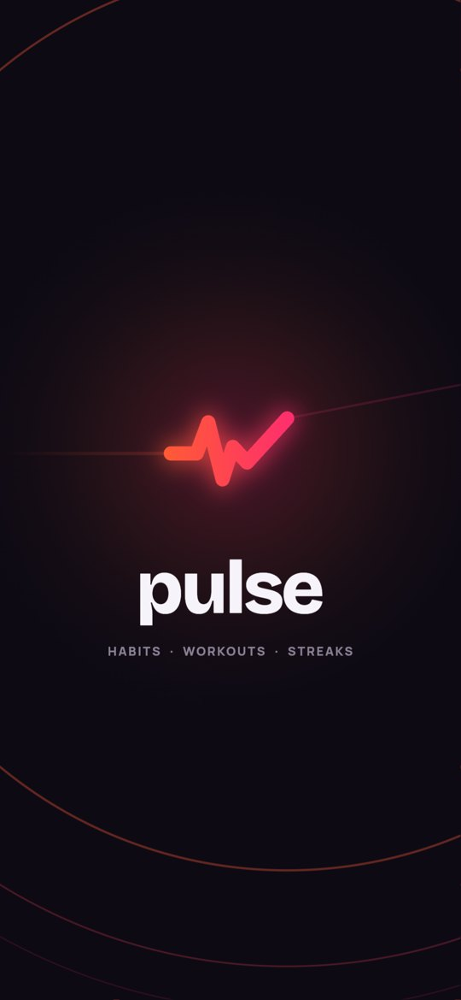
  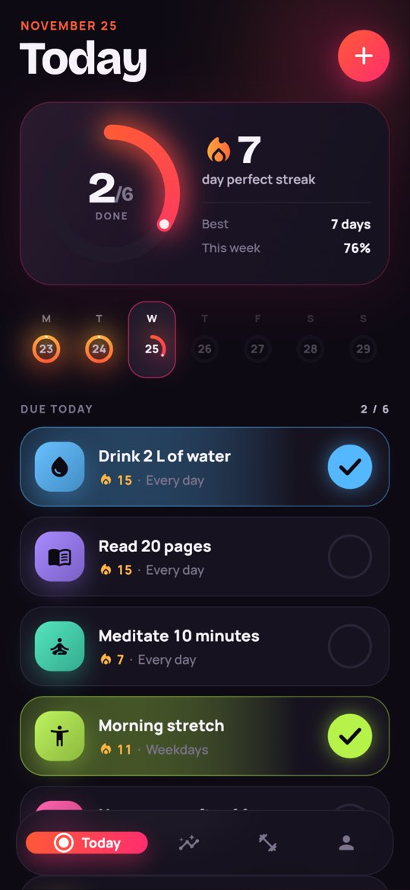
  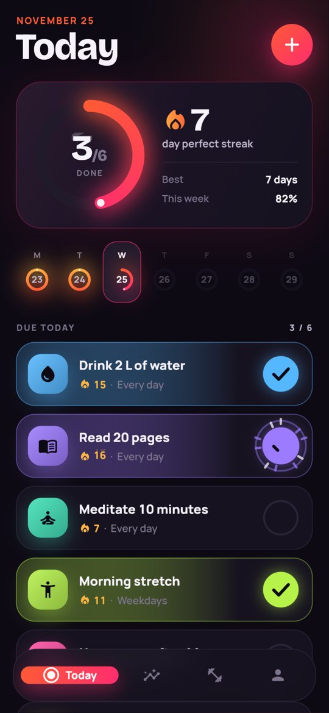
  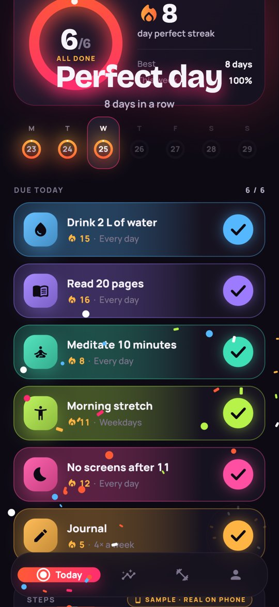
</p>
<p align="center">
  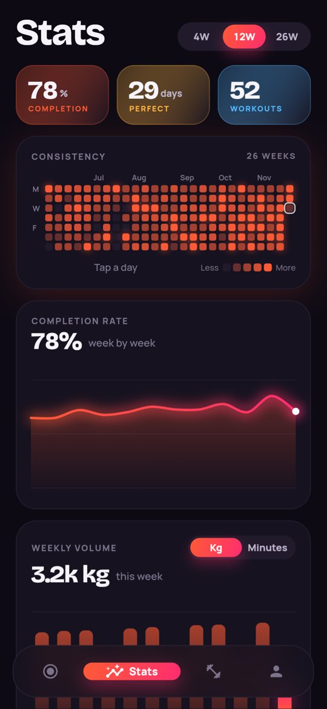
  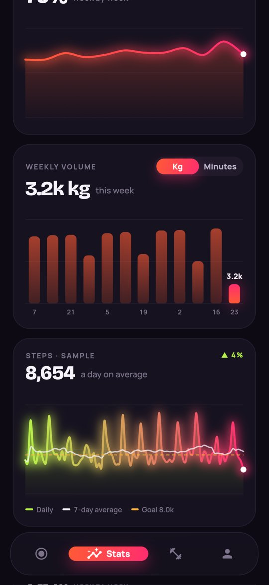
  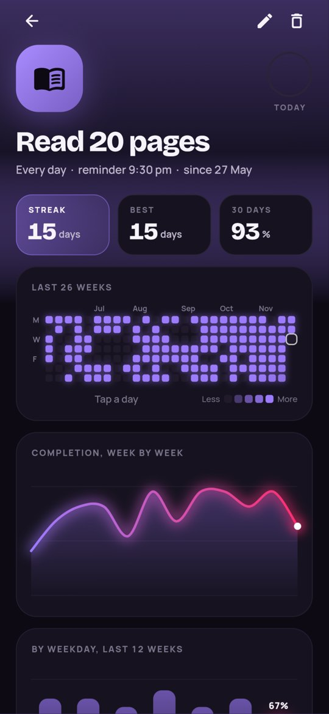
  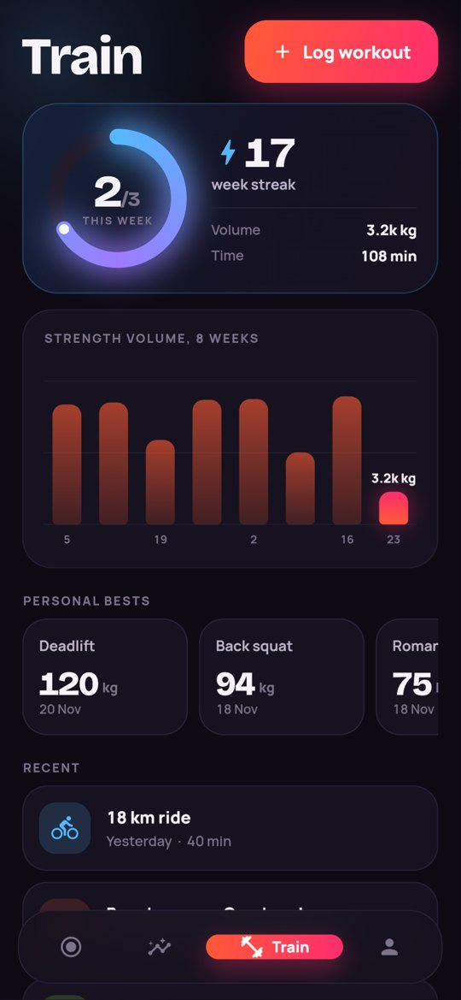
</p>
<p align="center">
  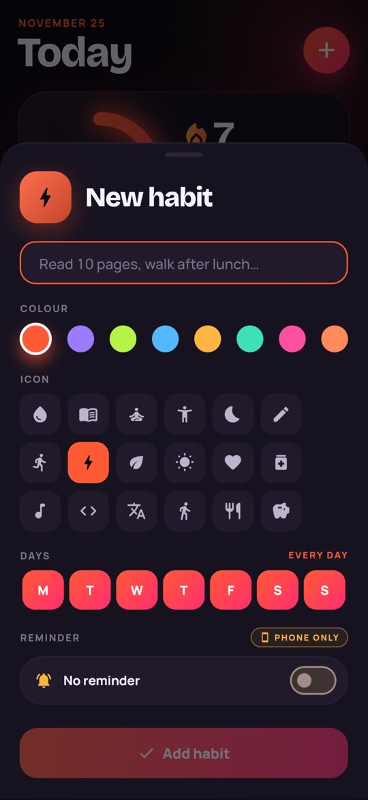
  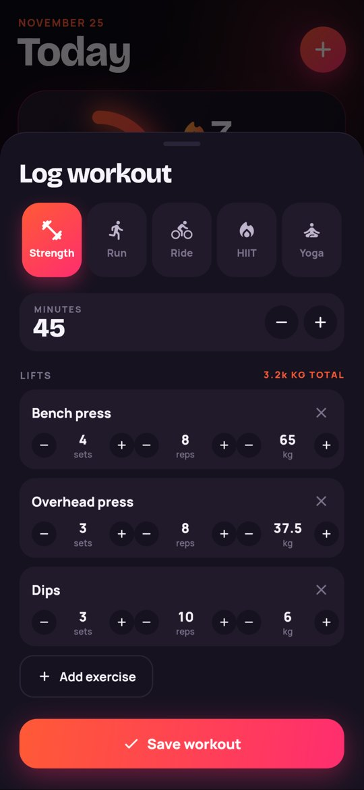
  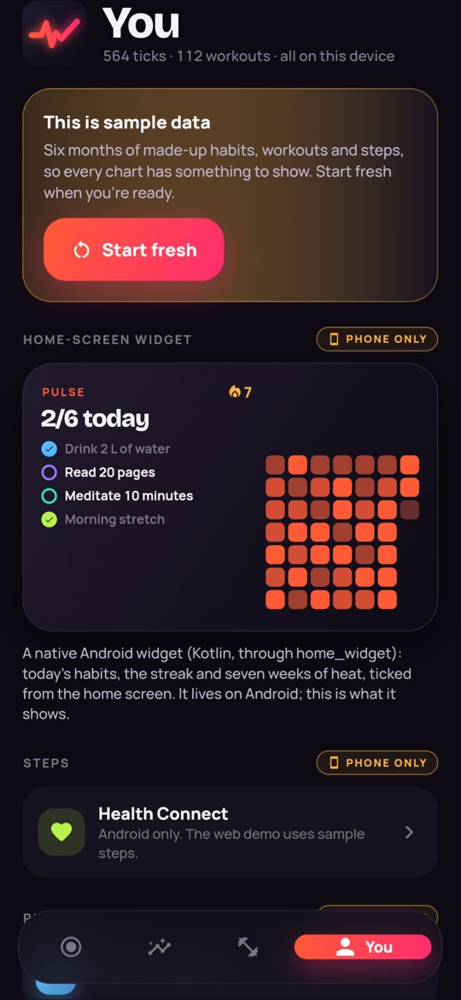
</p>

## On Android

The same app runs on Android, built from source, with three things the browser can't have:

<p align="center">
  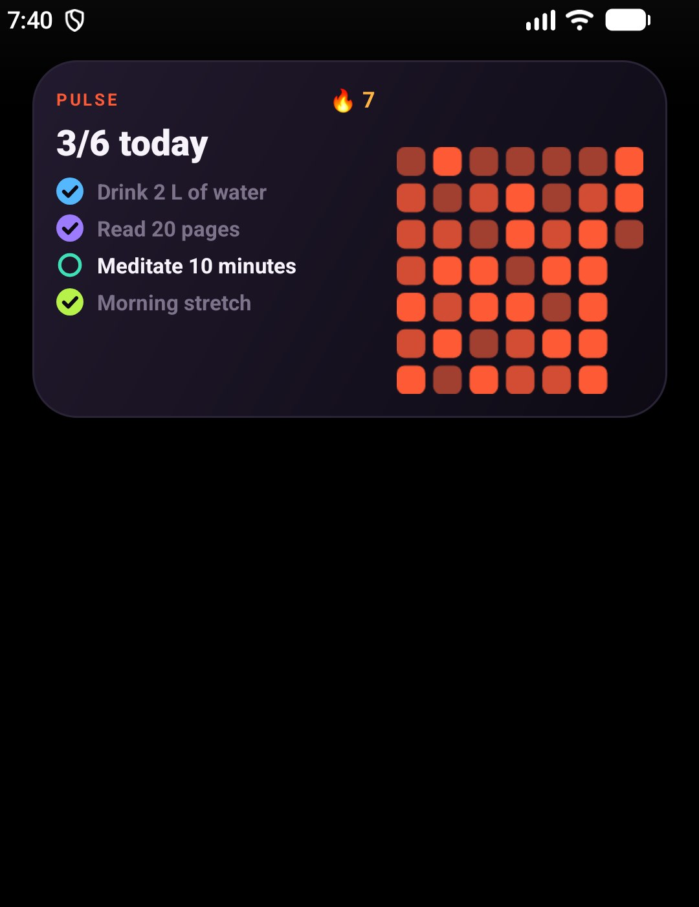
</p>
<p align="center">
  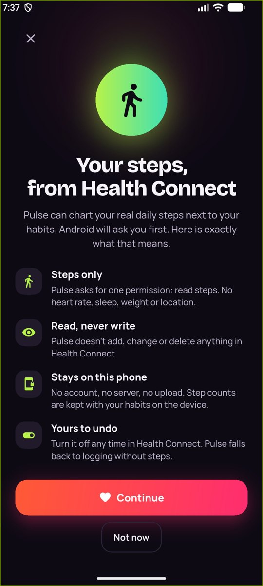
  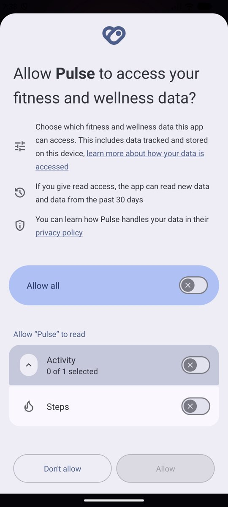
  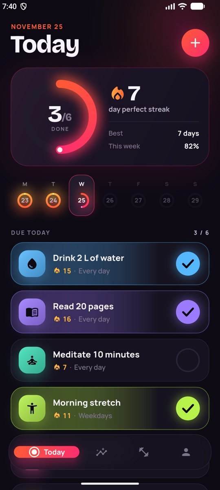
</p>

- **Home-screen widget**: native Kotlin (`PulseWidget.kt`) through `home_widget`. It shows today's habits, the perfect-day streak and a seven-week heatmap that Kotlin draws into a bitmap. Tap a habit on the widget and Pulse opens and ticks it, with the full check-off animation. The widget updates as you tick in the app.
- **Health Connect steps**: a small Kotlin bridge (`HealthBridge.kt`) reads daily step totals, read-only. Before Android asks, Pulse explains exactly what it wants: one permission (read steps), nothing written back, nothing uploaded. Health Connect's "why does Pulse need this?" link opens the same page.
- **Reminders**: one local notification per habit at the time you pick, scheduled on the phone and kept across reboots (`flutter_local_notifications`). No server.

On the web these appear marked as **phone only**, and the steps come from the sample data.

## Motion

Motion was designed with the screens, from one set of tokens (`lib/brand/tokens.dart`): fast ease-outs, a heartbeat-like overshoot for springy things, and near-zero durations when the system asks for reduced motion.

| Moment | What happens |
|---|---|
| **Splash** | A faint monitor line runs in from the left edge. It kicks into one heartbeat and finishes as a tick, with two beats of haptics. Shock rings spread from the tick and the wordmark springs up letter by letter. Then the screen gives one last thump and a circle opens from the tick, revealing Today, which starts its entrance at that moment. Tap to skip. The web loading screen traces the same line in the same colour, so nothing flashes. |
| **Check-off** | The ring sweeps round, the habit's colour blooms out of the centre with a bounce, the tick draws itself, and a shock ring and sparks fly out. You feel two haptic beats. The streak count rolls up like an odometer, the big ring kicks forward and the card washes with the habit's colour. Unticking just drains it. |
| **Perfect day** | Ticking the last habit of the day fires confetti from that button and a *Perfect day* banner with the run length. Hitting the weekly workout goal does the same with *Week done*. |
| **Heatmap** | Cells pop in as a wave from the oldest week to today, each with a little spring. Today's cell breathes. Tap any day to see what got done. |
| **Charts** | Bars grow with a spring, each a beat after the one before. Lines draw themselves in with a glowing head. When the data changes (a new range, a logged workout, minutes instead of kilos) every point springs to its new value, so the chart morphs instead of redrawing. Drag across a chart to scrub it. |
| **Opening a habit** | Its tile flies (Hero) into the detail page, which takes on the habit's colour. The rest of the page rises in a stagger. |
| **Tabs** | A floating frosted capsule. The active tab grows into a gradient pill and its label slides out of the icon. Tabs cross-fade with a small lift and keep their scroll position. |

## Features

- **Habits**: a name, one of 18 icons, one of eight colours, the weekdays it's due and an optional reminder time. Pick a past day in the week strip to fill it in late.
- **Streaks**: per habit, plus a *perfect-day* streak (every habit due that day done) and a *week* streak for workouts (weeks that hit your session goal). The rules are written down in `lib/data/streaks.dart`: days with nothing due are skipped, doing a habit on a day off counts as a bonus, and today is never a miss until it's over.
- **Workouts**: strength sessions with lifts (sets × reps × kg), runs and rides with distance, HIIT and yoga with minutes. A new strength session starts from your last one's lifts. Personal bests per exercise. Swipe a session away, with undo.
- **Stats**: completion rate (day by day over 4 weeks, week by week over 12 or 26), perfect days, sessions, weekly volume in kilos or minutes, and a step trend with a 7-day average and your goal.
- **Offline-first**: everything lives on the device (`shared_preferences`, localStorage on the web) and is written after every change. There is no account and no server. Corrupt or unknown saved data is dropped instead of crashing.
- **Sample data**: first launch opens on six months of seeded, believable history: habits that get steadier, a rough patch about two months in, three strength sessions a week with slow progressive overload, and steps that climb at weekends. *Start fresh* in the You tab clears it.
- **Deep links** into the web demo: `?tab=today|stats|train|you`, `?habit=<id>`, `?sheet=new|log`, `?splash=0`.
- **Accessibility**: every button, the check buttons included, is its own screen-reader node with a label ("Tick off Read 20 pages"), and all motion respects *reduce motion*. Titles and figures shrink instead of overflowing when the text is large.

## Design

Pulse is dark-first: a night field (`#0D0A14`) lit by one hot gradient, **ember** `#FF5A36` into **flare** `#FF2D6F`, with gold (`#FFB443`) for streaks and volt (`#B6F24A`) for steps. Each habit brings its own colour from a palette of eight. Headlines and figures are set in **Bricolage Grotesque** (heavy and tight), interface text in **Manrope**.

The mark is a heartbeat line whose last beat turns into a tick. It is one `CustomPainter` (`lib/brand/logo.dart`) that the splash animates, and the same painter renders every app icon (`flutter test tool/make_icons_test.dart`). The repository has no image assets.

## Architecture

```
lib/
  brand/     tokens.dart (colour, type, motion), logo.dart (the mark), icons.dart
  data/      days.dart (dates as day numbers), models.dart, streaks.dart, stats.dart, seed.dart
  state/     tracker.dart: habits, ticks, workouts, steps and storage (ChangeNotifier + InheritedNotifier)
  platform/  health.dart, reminders.dart, widget_sync.dart, phone.dart, demo_link.dart
  widgets/   check.dart (the check-off), heatmap.dart, charts.dart, ring.dart, confetti.dart, habit_card.dart, ui.dart
  screens/   splash, shell, today, habit_detail, stats, train, you, the habit and workout sheets, health_explainer
android/app/src/main/kotlin/dev/alok/pulse/
             PulseWidget.kt (home-screen widget), HealthBridge.kt (Health Connect), MainActivity.kt
```

Days are plain integers (days since 1970 in the local calendar), so streak maths never trips over time zones or daylight saving. The streak and chart maths in `data/` is pure Dart with no Flutter, so every number on screen is unit-tested.

## Testing

```
flutter analyze
flutter test
```

- `test/streaks_test.dart`: runs up to today, an open today that doesn't break the streak, scheduled versus unscheduled days, bonus days, days before a habit existed, best runs, perfect days and workout weeks.
- `test/stats_test.dart`: day scores, heatmap levels and layout (Monday first, future days blank), completion rates over scheduled days only, rates by weekday, weekly volume and minutes, step series, moving averages and trends, and stable sample data that opens on a live streak.
- `test/tracker_test.dart`: ticking and unticking, persistence round trip, filling in a past day, start fresh and load sample, delete with undo, workout goals, corrupt storage, real steps replacing sample ones, and deep links.
- `test/app_test.dart`: the splash hands over to Today; ticking counts and the last habit fires *Perfect day*; untick; adding a habit from the sheet (and refusing an empty name); opening a habit, deleting it and undoing; logging a workout; switching the stats range; and the web demo marking phone-only features.

CI checks formatting, analyzes, tests every push and deploys the web build to GitHub Pages.

## Run it

```
flutter pub get
flutter run -d chrome        # the web demo, with sample data
flutter run                  # an Android phone or emulator: widget, Health Connect, reminders
```

On Android 14 and newer, Health Connect is built in. On older versions, Pulse offers to install it from the Play Store. Health Connect only shares the last 30 days of history with a newly allowed app.

## Notes

- The habits, workouts and steps in the demo are made up and seeded, so every visit looks the same.
- Pulse reads steps and nothing else from Health Connect, and never writes to it.

## License

MIT.

---

<sub>One of eighteen projects by [Alok Kulkarni](https://alok.is-a.dev): [Hearth](https://github.com/alok-kul5/hearth-iot) home sensors · [Headway](https://github.com/alok-kul5/headway-transit) transit data · [Vigil](https://github.com/alok-kul5/vigil-soc) security triage · [Loupe](https://github.com/alok-kul5/loupe-vision) defect inspection · [Kharcha](https://github.com/alok-kul5/kharcha-finance) personal finance · [Stockroom](https://github.com/alok-kul5/stockroom-inventory) inventory · [Quietwire](https://github.com/alok-kul5/quietwire-villa) smart home design · [Canopy](https://alok.is-a.dev/canopy/) coffee storefront · [Picket](https://github.com/alok-kul5/picket) detection rules · [Warden](https://github.com/alok-kul5/warden-iac) cloud IaC scanning · [Marquee](https://github.com/alok-kul5/marquee-recs) recommendations · [Kestrel](https://github.com/alok-kul5/kestrel) fraud detection · [Almanac](https://github.com/alok-kul5/almanac-forecast) demand forecasting · [Quarry](https://github.com/alok-kul5/quarry-sql) data questions in plain English · [Quire](https://github.com/alok-kul5/quire) cited answers about Python · [Transit](https://github.com/alok-kul5/transit-mumbai) Mumbai trains · **Pulse** habit tracker · [Sieve](https://github.com/alok-kul5/sieve) job posts to clean data.</sub>
